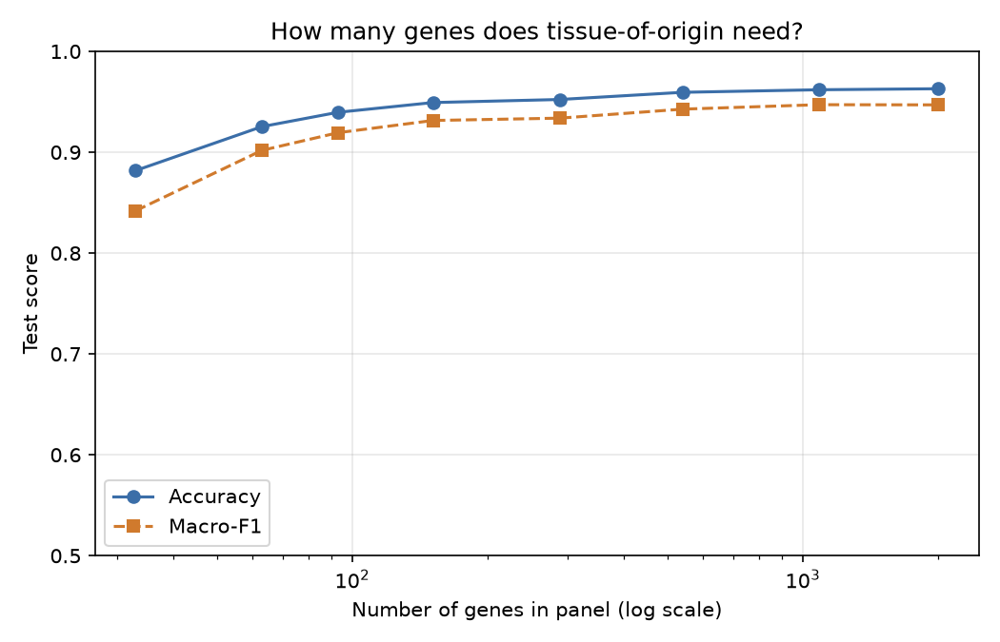
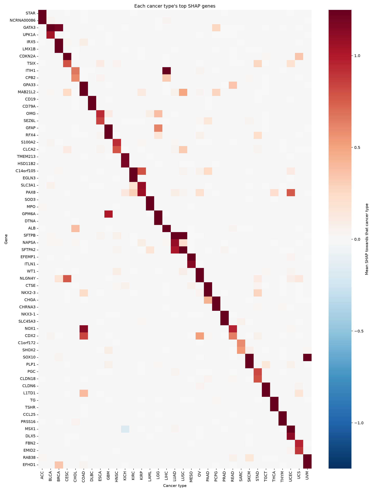
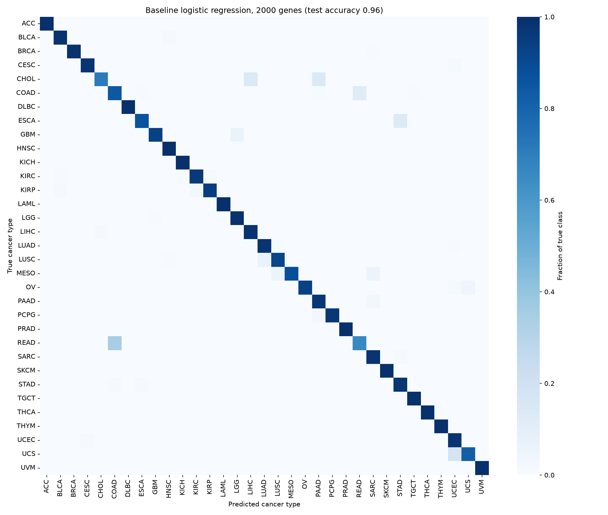
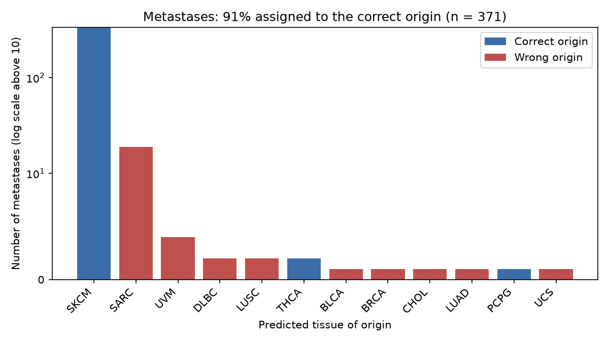

# Predicting a tumour's tissue of origin from gene expression (TCGA, 33 cancer types)

**Question:** Can a machine-learning model tell which tissue a tumour came from using only its RNA-seq profile? Which genes does it rely on, and how small can the gene panel get before accuracy drops?

About 2–5% of cancers are diagnosed as metastases whose primary site cannot be found (cancer of unknown primary, CUP). Pathologists narrow down the origin with immunohistochemistry markers such as TTF-1, CDX2, GATA3 or SOX10, and expression-based classifiers have been developed as an extra tool. In this project I train an interpretable tissue-of-origin classifier on 9,849 primary tumours from The Cancer Genome Atlas (TCGA). I then use SHAP to check whether the genes it uses are real tissue biology or shortcuts.

## Key findings

1. **Expression identifies the tissue of origin very accurately.** A regularised logistic regression on 2,000 genes classifies **96.3%** of held-out tumours correctly across 33 cancer types (macro-F1 0.949; 5-fold cross-validated balanced accuracy on the training set 0.933 ± 0.006). A LightGBM gradient-boosted tree model is not better (95.5%, macro-F1 0.928).
2. **The model rediscovers the markers pathologists use.** Without being given any biology, SHAP shows the model relies on textbook lineage markers: *TG* and *TSHR* (thyroid), *ALB* (liver), *NAPSA* and *SFTPB* (lung adenocarcinoma), *NKX3-1* (prostate), *GATA3* and the uroplakins *UPK1A/UPK2* (bladder), *SOX10* (melanoma), *CDX2* (rectum), *WT1* (ovary), *GFAP* (glioblastoma), *CD19/CD79A* (lymphoma), *MPO* (AML), *POU5F1*/OCT4 (germ cell) and *STAR/CYP17A1* (adrenal cortex).
3. **SHAP also exposed a shortcut.** Among the top genes for cervical and ovarian cancer were *NLGN4Y* (Y chromosome) and *TSIX* (X-inactivation). This means the model was partly using "the patient is female" rather than tumour biology. I removed the four genes that separate male from female patients almost perfectly (*NLGN4Y, PRKY, TSIX, XIST*) and retrained the model. Accuracy was unchanged (96.3%, macro-F1 0.947), so the model does not *need* the shortcut. It is still a good reminder to check what a model is using.
4. **A few dozen genes get most of the way.** With only the top gene per cancer type (33 genes), accuracy is 88.2%. With 3 per type (93 genes) it is 94.0%, and with 5 per type (151 genes) it is 94.9%. Going up to 2,000 genes adds only about 1.5 percentage points.
5. **The errors are biologically sensible.** The main confusions are rectum vs colon (READ F1 0.66), uterine carcinosarcoma vs endometrial carcinoma (UCS 0.78), cholangiocarcinoma vs liver and pancreas (CHOL 0.77), and oesophageal vs stomach (ESCA 0.90). These are neighbouring or closely related tissues, and TCGA itself often merges colon and rectum.
6. **It mostly still works on metastases.** I trained the model on primary tumours only and then tested it on 371 TCGA metastases it had never seen (367 melanoma, mostly lymph node, skin and soft-tissue metastases, plus 4 others). It assigned **91.4%** to the correct origin (melanoma: 336/367, 91.6%). Many of the errors make sense. Nineteen were called sarcoma, which may reflect the soft tissue around a metastasis or melanomas that look mesenchymal. Four were called uveal melanoma, which is the same melanocyte lineage. Two were called lymphoma, possibly because the sample included surrounding lymph-node tissue. The model's confidence was also informative: the median predicted probability was 0.99 for correct calls and 0.66 for wrong ones, so low confidence flags the cases to double-check.

## Figures

**How many genes are needed?** (test set; panels are ranked using the training set only)



**Which genes drive each prediction** (LightGBM + SHAP; top 2 genes per cancer type, mean SHAP towards each type)



**Where the model goes wrong** (baseline logistic regression, rows sum to 1)



**Metastases: what the model predicted** (trained on primary tumours only; blue = correct origin, red = wrong origin)



The 20 most important genes overall are in [`results/shap_global_top20.png`](results/shap_global_top20.png).

## Data

All data are public, from the UCSC Xena TCGA Pan-Cancer Atlas hub:

- **Expression:** batch-corrected PanCan RNA-seq (EB++AdjustPANCAN), log2(normalised count + 1), 20,531 genes
- **Cancer-type labels:** TCGA Clinical Data Resource (Liu et al., 2018)

I kept primary tumours only (TCGA sample code 01, or 03 for AML) and one tumour per patient, which gives 9,849 tumours across 33 cancer types (36 to 1,095 per type). I removed genes with any missing values (never imputed) or a mean log2 expression below 1, which leaves 16,177 genes. A stratified 80/20 split gives 7,879 training and 1,970 test tumours. The test set is only used for final scoring. Raw data are not stored in this repo; `src/00_download_data.sh` downloads them.

## Methods

| Step | Script | What it does |
|---|---|---|
| 0 | `00_download_data.sh` | Downloads the expression matrix and clinical table (~330 MB) |
| 1 | `01_prepare_data.py` | Selects primary tumours, attaches cancer-type labels, filters genes, makes the train/test split |
| 2 | `02_baseline_model.py` | Picks the 2,000 most variable genes (training set only, inside the pipeline), then standardises them and fits a multinomial logistic regression (L2, C = 0.1). Reports 5-fold CV, test metrics and the confusion matrix |
| 3 | `03_lightgbm_shap.py` | LightGBM classifier on the same genes, with SHAP (TreeExplainer) on 600 random test tumours. Reports the top genes pushing tumours of each type towards that type |
| 4 | `04_sex_genes_and_minimal_panel.py` | Finds sex-linked genes (male vs female AUC > 0.9 or < 0.1 in training tumours of cancer types seen in both sexes) and removes them. Then ranks genes per cancer type by the logistic-regression coefficient and scores panels of 1–50 genes per type on the test set |
| 5 | `05_metastasis_test.py` | Trains the step-4 model on primary tumours, then predicts the origin of TCGA metastatic samples (code 06). Patients whose primary tumour was in the training set are excluded |

Gene selection, scaling and ranking only ever use the training set, so no information from the test set leaks into the model.

## Limitations

- **The metastasis test is almost all melanoma.** TCGA has very few metastatic samples from other cancers, and melanoma is a distinctive lineage (*SOX10*, *PMEL*). Metastases from carcinomas, especially to organs like the liver or lung where host tissue dominates, would be a harder test.
- **One cohort, one platform.** All samples are TCGA RNA-seq processed the same way. Performance on other cohorts, sequencing protocols or FFPE material is unknown.
- **Labels are TCGA projects, not pure tissues.** Some classes are biologically overlapping (COAD/READ, UCEC/UCS, LUAD/LUSC). Part of the "error" there reflects how TCGA defines its cancer types.
- **Small classes give noisy scores.** CHOL has only 7 test tumours, so its per-class score is uncertain.
- **The SHAP analysis was run before sex-linked genes were removed**, so those genes still appear in the SHAP outputs. The panel results in step 4 do not include them.
- **The panel curve uses the test set for each panel size.** It describes the trade-off and was not used to tune a final model. A fully nested design would give a slightly more conservative estimate.
- Bulk RNA-seq mixes tumour, immune and stromal cells, so some marker genes may come from the surrounding tissue rather than the cancer cells.

## Next steps

- Test the classifier on an independent metastasis cohort with many primary sites (e.g. MET500)
- Merge COAD/READ and LUAD/LUSC as a sensitivity analysis
- Compare the minimal panel with published CUP classifier gene sets
- Rerun SHAP without the sex-linked genes

## Reproduce

```bash
git clone https://github.com/prithviraj-dasgupta/tcga-tissue-of-origin.git
cd tcga-tissue-of-origin
conda env create -f environment.yml
conda activate origin
bash src/00_download_data.sh
python src/01_prepare_data.py
python src/02_baseline_model.py
python src/03_lightgbm_shap.py
python src/04_sex_genes_and_minimal_panel.py
python src/05_metastasis_test.py
```

Each script takes a few minutes on a laptop (tested on an Apple Silicon MacBook Pro).

## Outputs

- `results/baseline_metrics.txt` and `results/lgbm_metrics.txt` contain the per-class precision, recall and F1
- `results/shap_top_genes_per_type.csv` lists the top 5 SHAP genes per cancer type
- `results/sex_linked_genes_removed.txt`
- `results/panel_size_vs_accuracy.csv` and `results/minimal_panel_genes.csv` (3 genes per type)
- `results/metastasis_predictions.csv` gives the prediction and confidence for each metastasis
- Figures: `results/*.png`

## References

- Hoadley KA, et al. (2018). Cell-of-origin patterns dominate the molecular classification of 10,000 tumors from 33 types of cancer. *Cell* 173(2):291–304.
- Liu J, et al. (2018). An integrated TCGA pan-cancer clinical data resource to drive high-quality survival outcome analytics. *Cell* 173(2):400–416.
- Goldman MJ, et al. (2020). Visualizing and interpreting cancer genomics data via the Xena platform. *Nature Biotechnology* 38:675–678.
- Lundberg SM, Lee S-I (2017). A unified approach to interpreting model predictions. *NeurIPS* 30.
- Ke G, et al. (2017). LightGBM: a highly efficient gradient boosting decision tree. *NeurIPS* 30.
